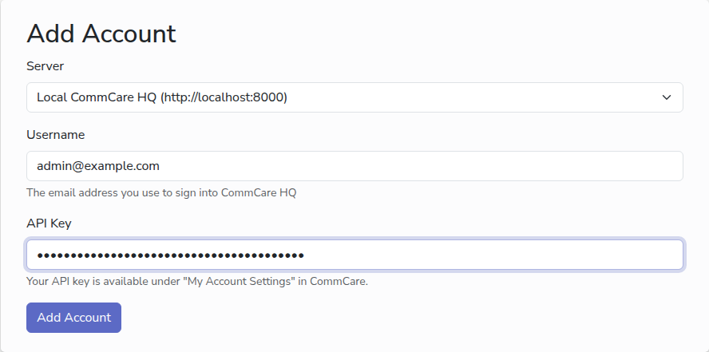

# Add a CommCare account

An account holds the CommCare HQ login that CommCare Data Pipeline uses to read
your data: a username and an API key. One account can serve every project space
on the same server that its user can see.

## Before you start

- A CommCare HQ web user who can see the project space you want to export. The
  data that reaches your database is the data this user is allowed to see.
- An API key for that user. In CommCare HQ, open the user menu in the top right,
  choose **My Account Settings**, then **API Keys**. Give the key a name such as
  `Data Pipeline`, and copy it straight away: CommCare HQ shows a key only once.

<!-- prettier-ignore-start -->
> [!TIP]
> Make a key just for CommCare Data Pipeline, so that you can turn it off later
> without affecting anything else. Treat it like a password.
<!-- prettier-ignore-end -->

## Steps

1. In the sidebar, under **CommCare Management**, click **Accounts**, then **Add
   Your First Account**, or **New Account** once there is one.
2. Under **Server**, pick the CommCare HQ server. When the app knows only one
   server, the box shows it and cannot be changed.
3. In **Username**, type the email address the user signs in to CommCare HQ
   with.
4. In **API Key**, paste the key.
5. Click **Add Account**.

The key is stored encrypted and is never shown again. To replace it, edit the
account and paste a new one.

## Next

- [Add a database](add-database.md)
