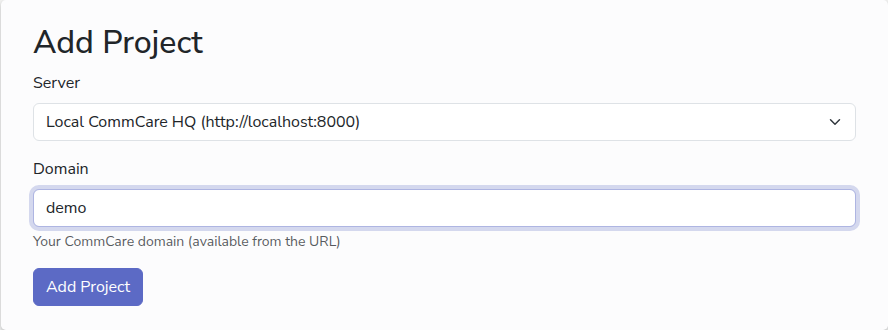

# Add a CommCare project

A project tells CommCare Data Pipeline which CommCare HQ project space to export
data from. Add one for each project space you work with.

## Before you start

- The name of your project space. It is in the address bar when you are in
  CommCare HQ: in `https://www.commcarehq.org/a/my-project/...`, the project
  space is `my-project`.

## Steps

1. In the sidebar, under **CommCare Management**, click **Projects**, then **Add
   Your First Project**, or **New Project** once there is one.
2. Under **Server**, pick the CommCare HQ server that hosts your project space.
   When the app knows only one server, the box shows it and cannot be changed.
3. In **Domain**, type the project space name, for example `demo`. Type only the
   name, not the whole address.
4. Click **Add Project**.

The project appears in the list, linked to its dashboard in CommCare HQ.

<!-- prettier-ignore-start -->
> [!NOTE]
> The app comes with `www.commcarehq.org` as its only server. If your
> organisation uses another CommCare HQ, such as the India or EU servers or one
> you host yourself, an administrator adds it first: open the ≡ menu in the top
> right, choose **Admin Site**, and under **CommCare** add a **Comm care
> server** with a name and its address, for example
> `https://india.commcarehq.org`.
<!-- prettier-ignore-end -->

## Next

- [Add a CommCare account](add-commcare-account.md)
