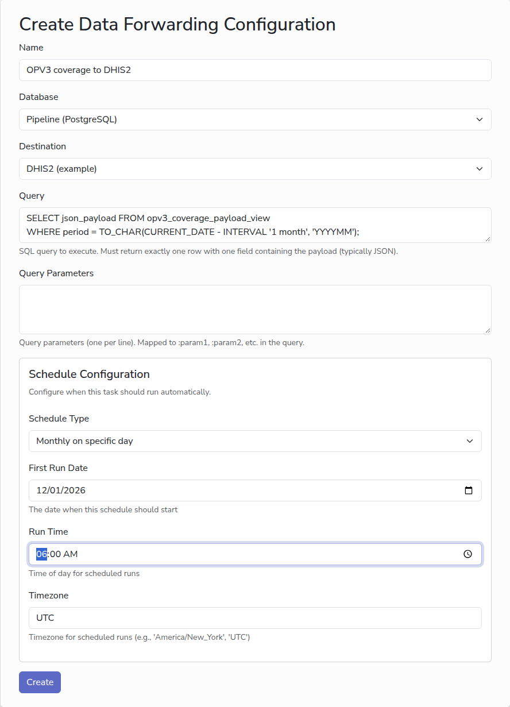

# Forward data

A forwarder sends the result of a database query to another system on a
schedule. It is how summary data leaves your database: to a reporting platform
such as DHIS2, or back to CommCare HQ as a lookup table.

A forwarder has two parts. A **destination** is the address and login of the
system that receives the data, and only an administrator can add one. A
**forwarder** pairs a destination with the query that produces what to send.

## Before you start

- [A database](add-database.md) that holds the data to send.
- A view or query in that database that returns exactly one row with one column,
  containing the whole body of the request to send, usually as JSON. Shaping the
  data for the receiving system is done in the database, by whoever writes your
  SQL.
- The address of the receiving system's API, and a username and password for it.
  Ask the system's administrator for a dedicated login with only the permissions
  it needs.

## Add the destination

Administrators only.

1. In the sidebar, under **Data Forwarding**, click **Destinations**, then **New
   Destination**.
2. In **Name**, type a name for the system, for example `National DHIS2`.
3. In **API URL**, paste the full address to send to, for example
   `https://dhis2.example.org/api/dataValueSets`.
4. Leave **HTTP Method** as `POST` unless the API documentation says to use
   `PUT`.
5. Type the **API Username** and **API Password**. The password is stored
   encrypted.
6. Click **Create**.

## Add the forwarder

1. In the sidebar, under **Data Forwarding**, click **New Forwarder**.
2. In **Name**, type a name for the forwarder, for example
   `OPV3 coverage to DHIS2`.
3. Pick the **Database** and the **Destination**.
4. In **Query**, type the query that returns the body to send. For example, with
   a view that builds a DHIS2 payload for a given month:

   ```sql
   SELECT json_payload FROM opv3_coverage_payload_view
   WHERE period = TO_CHAR(CURRENT_DATE - INTERVAL '1 month', 'YYYYMM');
   ```

5. Leave **Query Parameters** empty unless whoever wrote your query told you it
   takes parameters; then type one value per line, in the order the query
   expects them.
6. Choose a schedule. A monthly report is usually sent a few days into the next
   month. See [Schedules](schedules.md).
7. Click **Create**.



## Run it

Click **Run Now** on the forwarder's page to send once. The run's log shows
where the data went, how big it was, and the status code the receiving system
answered with (`200` or `201` means it was accepted), which is where to look
when the data does not arrive.

## What the receiving system expects

- **DHIS2** takes aggregate data as a JSON document with a `dataValues` list,
  each value naming the data element, period, organisation unit and category
  option combination by their DHIS2 identifiers. See
  [sending data values](https://docs.dhis2.org/en/develop/using-the-api/dhis-core-version-master/data.html#webapi_sending_data_values)
  in the DHIS2 developer documentation.
- **CommCare HQ lookup tables** take a JSON document describing the table's
  fields and rows, sent with `PUT` to the table's address, or one row at a time
  with `POST`. The username is the CommCare HQ web user's email address and the
  password is an API key. See the
  [lookup table API](https://commcare-hq.readthedocs.io/api/fixture.html).

## Next

- [Monitor runs](monitor-runs.md)
