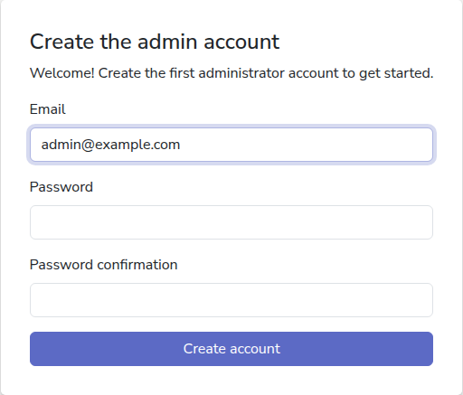

# Install CommCare Data Pipeline

CommCare Data Pipeline runs on your own computer. Install it once, and it keeps
copying your CommCare data into your database on a schedule for as long as it is
open.

## Before you start

- A Windows PC, a Mac, or a Linux computer that can reach CommCare HQ and your
  database.
- The download for your computer. Pilot users get it from the
  [pilot guide](pilot_guide.md).

## Windows

1. Download `CommCare-Data-Pipeline-Setup-<version>.exe` and open it.
2. If Windows says "Windows protected your PC", click **More info**, then **Run
   anyway**. Pilot builds are not yet signed, so Windows does not recognise the
   publisher.
3. Follow the installer. It needs no administrator rights: it installs for your
   user account and adds **CommCare Data Pipeline** to the Start Menu.
4. Open **CommCare Data Pipeline** from the Start Menu.

## macOS

1. Download the zip for your Mac: `arm64` for Apple Silicon (M1 and later),
   `x86_64` for Intel. If you are not sure, open the Apple menu and choose
   **About This Mac**.
2. Double-click the zip to unpack **CommCare Data Pipeline**, and move it to
   your Applications folder.
3. Open it. If macOS says "Apple could not verify ... is free of malware", click
   **Done**, then open **System Settings → Privacy & Security**, scroll down to
   **Security**, and click **Open Anyway** next to the message about CommCare
   Data Pipeline. Pilot builds are not yet signed, so macOS asks once.

## Linux

There is no packaged build for Linux yet. Run the app from a checkout with
[uv](https://docs.astral.sh/uv/getting-started/installation/):

```shell
git clone https://github.com/dimagi/commcare-sync.git
cd commcare-sync
uv sync --extra postgres
uv run commcare-sync --desktop
```

Add `--extra mysql` or `--extra odbc` for MySQL or SQL Server. The app opens in
your browser. To run it on a shared server instead, see
[Run on a server](server.md).

## First run

The first time the app opens, it shows the setup page. Enter your email address,
type a password twice, and click **Create account**. This is the administrator
account. You are signed in and the app is ready for
[your first project](add-commcare-project.md).



<!-- prettier-ignore-start -->
> [!NOTE]
> The setup page can only be used on the computer the app runs on, so that
> nobody else can claim the administrator account.
<!-- prettier-ignore-end -->

## Day to day

- **Leave it open.** Scheduled exports, refreshes and forwarders run while the
  app is open. Closing the window stops the app, and them, until you open it
  again.
- **Closing during a run.** If a run is in progress when you close the window,
  the app asks first. If you quit anyway, the run is marked **Interrupted** and
  runs again the next time you open the app.
- **If the app opened in your browser** rather than in its own window, which is
  what happens on Linux, closing the browser tab does not stop it. Stop it by
  pressing Ctrl+C in the terminal you started it from, or by creating an empty
  file named `stop` in the data directory (see below).
- **Opening it twice.** If the app is already running, opening it again shows
  the running app in your browser instead of a second window.
- **Updating.** Install the new version over the old one. Your settings, data
  and logs are kept.

## Where your data is

The app keeps its own database, encryption keys, logs and uploaded files in a
data directory for your user account:

| Platform | Data directory                                |
| -------- | --------------------------------------------- |
| Windows  | `%LOCALAPPDATA%\commcare-sync`                |
| macOS    | `~/Library/Application Support/commcare-sync` |
| Linux    | `~/.local/share/commcare-sync`                |

To open it, paste the path into the address bar of File Explorer on Windows, or
in Finder choose **Go → Go to Folder** and paste it, since the Library folder is
hidden.

Uninstalling leaves the data directory in place. Delete it by hand to start
over.

## Which databases work

Exports write to a PostgreSQL, MySQL or SQL Server database that you provide.
PostgreSQL and MySQL need nothing more. SQL Server needs
[Microsoft's ODBC Driver for SQL Server](https://learn.microsoft.com/sql/connect/odbc/download-odbc-driver-for-sql-server),
a separate install on every platform. Without it, an export to SQL Server fails
with a message about the driver.

## Next

- [Add a CommCare project](add-commcare-project.md)
