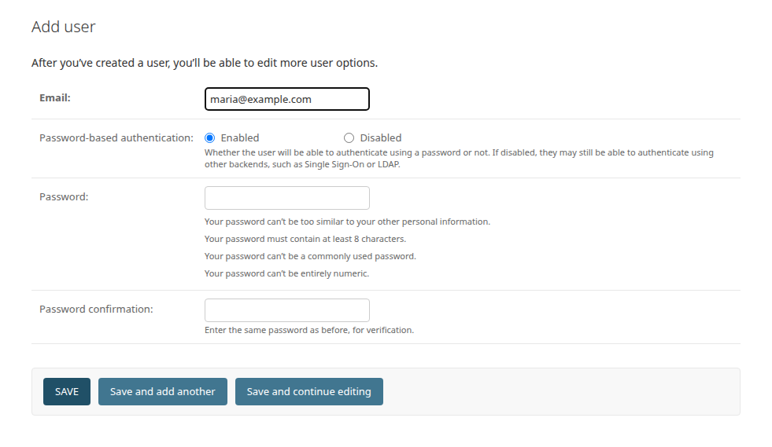

# Manage users

Each person who uses CommCare Data Pipeline signs in with their own email
address and password. Administrators add users and reset passwords in the
**Admin Site**. This page is for administrators; the last section is for
everyone.

## Who can do what

Any signed-in user can add projects and accounts, set up exports, refreshes and
forwarders, and run them. Only an administrator can:

- add, edit or delete a [database](add-database.md) or a
  [destination](forward-data.md),
- download the export tool's log (see [Troubleshooting](troubleshooting.md)),
- open the **Admin Site** to manage users and CommCare HQ servers.

The account created on the setup page is an administrator. Before handing the
app to a colleague who will add databases, make them an administrator too, or
add the databases for them.

## Add a user

1. Open the ≡ menu in the top right and choose **Admin Site**.
2. Under **Users**, click **Add** next to **Users**.
3. Type the person's **Email** and a **Password** twice. The password must be at
   least 8 characters and not too simple.
4. Click **Save**. The user's full page opens, where you can add their name.
5. To make them an administrator, tick **Staff status** and **Superuser status**
   under **Permissions**, and click **Save** again.

Tell the person their password. They can change it after signing in.

## Reset a password

The **Forgot password?** link on the sign-in page needs an email server that the
app does not have, so an administrator resets passwords:

1. In the **Admin Site**, under **Users**, click **Users** and open the person.
2. Next to **Password**, click **Reset password**.
3. Type the new password twice and click **Change password**.

## Remove a user

Open the person in the **Admin Site**, untick **Active**, and click **Save**.
They can no longer sign in, and everything they set up stays. Deleting a user
instead also deletes the CommCare accounts they added, and is refused while an
export still uses one of them, so deactivating is usually the better choice.

## Your own account

Everyone can open the ≡ menu in the top right to:

- **Profile**: change your name, and add a picture.
- **Change Password**: choose a new password.
- **Sign Out**.

## Next

- [Troubleshooting](troubleshooting.md)
