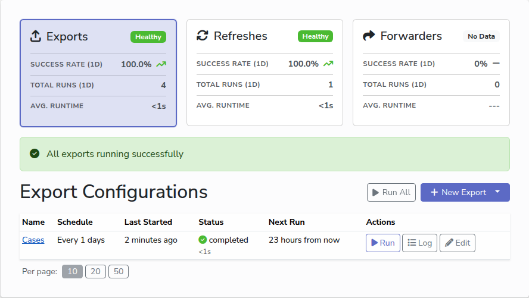

# Monitor runs

Every export, refresh and forwarder keeps a history of its runs. This page
explains what the app shows you about them, and where to look when something did
not finish.

## The health cards

The **Exports**, **Refreshes** and **Forwarders** pages each start with the same
three cards, one per kind of task, covering the last 24 hours:

- **Success rate**: completed runs as a share of all runs that started. Runs
  still waiting to start are not counted.
- **Total runs**: how many runs started.
- **Avg. runtime**: how long the completed runs took on average.

The badge on each card sums it up: **Healthy** at 95% success or better,
**Warning** from 80%, **Issue** below that, and **No Data** when nothing ran.
Below the cards, a banner says the same for the page you are on, and counts the
runs that failed.

## The list

The table lists every task of that kind, with its schedule, when it last started
and how it ended, and when it runs next. **Paused** means it has no schedule.
**Overdue** means a run is more than a few minutes late while the app is open,
which should not happen; see [Troubleshooting](troubleshooting.md) if it stays
that way. The **Run** button runs it now, and **Log** shows its latest log.

## Run history

Click a task's name to open its page. Click a run's date to open the run itself,
for example to see each project space of a multi-project export, or each view of
a refresh under **Details**. Its **Run History** lists each run with the time it
was created and its status:

- **queued**: waiting to start.
- **started**: running now.
- **completed**: finished without error.
- **failed**: stopped with an error. Click **Log** to see it.
- **skipped**: a queued run that an administrator cleared before it started.
- **interrupted**: the app was closed, or stopped, while the run was going. It
  is run again once, automatically, the next time the app starts.

Use the **Status** button above the table to show only the statuses you care
about. Click **Log** on a run to read what it did. For an export, the log shows
how many records were received and which tables were written; for a refresh, the
result of each view; for a forwarder, where the data went, how big it was, and
the status code the receiving system answered with.

## Runs that did not finish

When a run has failed or been interrupted in the last 24 hours, a banner at the
top of every page lists it, so that you notice even if you are working elsewhere
in the app. Close the banner with the cross once you have looked; it comes back
if another run fails.

## Next

- [Troubleshooting](troubleshooting.md)
