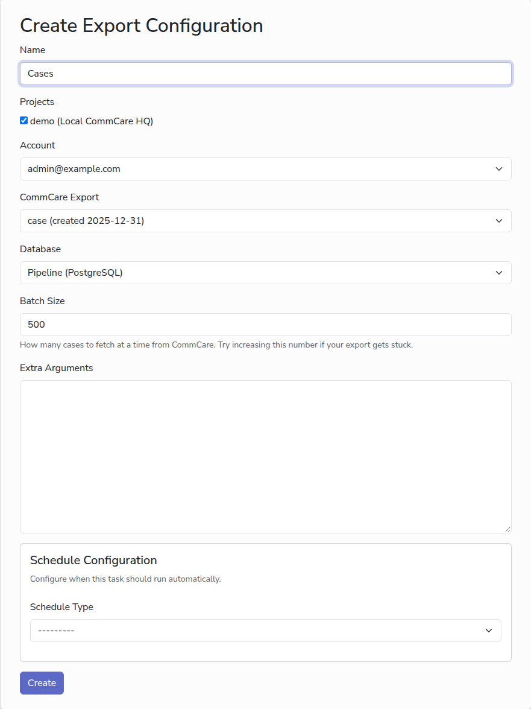

# Export from several projects at once

A multi-project export runs the same saved export against several project spaces
and writes the results into one database. Use it when several projects use the
same CommCare application and you want their data side by side.

## Before you start

- [A project](add-commcare-project.md) for each project space.
- [One account](add-commcare-account.md) whose user can see all of them, on the
  same server.
- [A database](add-database.md).
- The saved export in one of the project spaces, as in
  [Set up an export](set-up-export.md).

## Steps

1. In the sidebar, under **Export Management**, click **Multi-Project Export**.
2. In **Name**, type a name for the export.
3. Under **Projects**, tick each project space to include.
4. Pick the **Account**, then the **CommCare Export** from the list that fills
   in.
5. Pick the **Database**, choose a schedule or leave it empty, and click
   **Create**.

## How it runs

Each run of a multi-project export is one run per project space, grouped under a
parent run. The parent run shows **completed** when every project space
finished, **failed** when they all failed, and **Multiple results** when some
did and some did not. Click the parent run's date to see each project space on
its own, with its own log.

Every project space's data goes into the same tables, with the project space
name in the `domain` column.

## Next

- [Monitor runs](monitor-runs.md)
