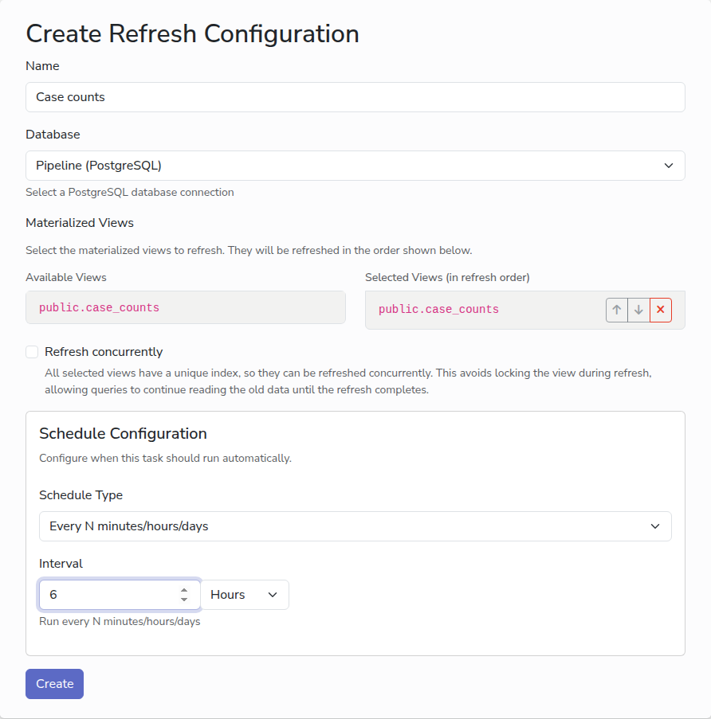

# Refresh materialized views

A materialized view is a saved query result in your database, such as a monthly
summary of your exported data. It does not update itself, so a refresh in
CommCare Data Pipeline rebuilds it on a schedule, after each export has brought
in new data.

## Before you start

- [A PostgreSQL database](add-database.md). Refreshes work with PostgreSQL only.
- One or more materialized views that already exist in that database. Creating
  the view is done in the database, by whoever writes your SQL. The app only
  refreshes it.

## Steps

1. In the sidebar, under **Scheduled Refreshes**, click **New Refresh**.
2. In **Name**, type a name for the refresh, for example `Case counts`.
3. Pick the **Database**. Only PostgreSQL databases are listed. The app connects
   to it and lists its materialized views under **Available Views**.
4. Click each view to refresh. It moves to **Selected Views**, which are
   refreshed in the order shown. Use the arrows to reorder them when one view
   depends on another.
5. Tick **Refresh concurrently** if it is offered. The view then stays readable
   while it is being rebuilt. It is offered only when every selected view has a
   unique index, which PostgreSQL needs for a concurrent refresh.
6. Choose a schedule. Refreshing an hour or so after the export that feeds the
   view is a good rule. See [Schedules](schedules.md).
7. Click **Create**.

## Run it

Click **Run Now** on the refresh's page to try it. Click **Details** on a run to
see the result for every view, so you can tell which one failed if the run did.

## Next

- [Forward data](forward-data.md)
- [Monitor runs](monitor-runs.md)
