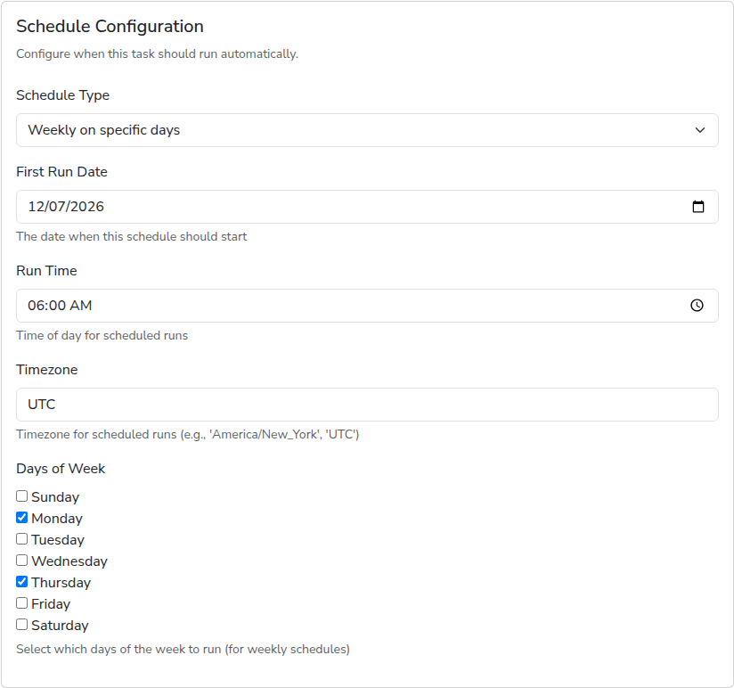

# Schedules

Exports, refreshes and forwarders share the same schedule settings. A schedule
runs the task while the app is open, without you doing anything.

## Choosing a schedule

The **Schedule Type** list offers:

- **Every N minutes/hours/days**: type the interval, for example `6` and
  `Hours`, or `1` and `Days`. The first run happens one interval after you save.
- **Weekly on specific days**: tick the days, and set the time.
- **Monthly on specific day**: runs each month on the day of the month of the
  first run date. A day such as the 31st is skipped in months that do not have
  it.
- **Quarterly**, **Semi-annually (twice per year)** and **Annually**: run on the
  first run date, then every three, six or twelve months.

Except for the interval type, you set the **First Run Date**, the **Run Time**,
and the **Timezone** the time is in, as a name such as `Africa/Nairobi` or
`UTC`.

## Running on demand

Leave **Schedule Type** empty to run a task only when you click **Run Now** on
its page. The list page marks it **Paused**. Set a schedule again at any time by
editing it.

## What to expect

- The list pages show when each task ran last, and when it runs next. A task
  that missed its time while the app was closed catches up with one run as soon
  as the app is open again. **Overdue** means a run is more than a few minutes
  late while the app is open, which should not happen; see
  [Troubleshooting](troubleshooting.md) if it stays that way.
- Runs never overlap. If a task is still running when its next time comes, that
  scheduled run is skipped, and the one after runs as usual.
- The app has to be open. See [Install](install.md#day-to-day).

## Next

- [Monitor runs](monitor-runs.md)
