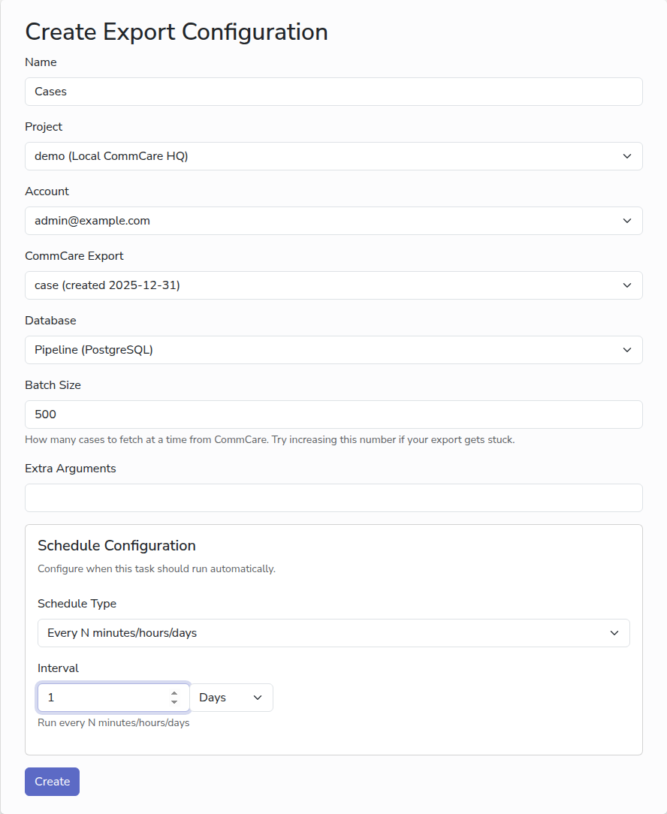

# Set up an export

An export copies the data from one of your saved CommCare HQ exports into your
database, and keeps it up to date on a schedule. This is the heart of CommCare
Data Pipeline; everything else builds on it.

## Before you start

- [A project](add-commcare-project.md), [an account](add-commcare-account.md)
  and [a database](add-database.md).
- A saved export in CommCare HQ for the data you want: in CommCare HQ, under
  **Data**, open **Export Form Data** or **Export Case Data** and save an export
  with the fields you need. CommCare Data Pipeline reads the list of saved
  exports from CommCare HQ; you do not upload anything.

## Steps

1. In the sidebar, under **Export Management**, click **New Export**.
2. In **Name**, type a name for the export, for example `Cases`.
3. Pick the **Project** and the **Account**. Once both are chosen, the
   **CommCare Export** list fills with the exports saved in CommCare HQ for that
   project, as seen by that account.
4. Pick the **CommCare Export** to run.
5. Pick the **Database** to write to.
6. Leave **Batch Size** at `500` unless an export gets stuck, and leave **Extra
   Arguments** empty unless you have been told what to put there.
7. Choose a schedule, or leave **Schedule Type** empty to run the export only
   when you ask. See [Schedules](schedules.md).
8. Click **Create**.

## Run it

The export's page opens, with its settings at the top and its **Run History**
below. Click **Run Now** to run it straight away; the new run appears in the
table and its status changes from **queued** to **started** to **completed** as
it goes. Click **Log** on a run to see what it did, including how many records
it received.

The first run copies everything. Later runs copy only what has changed in
CommCare since the previous run, so they are quick. To copy everything again,
tick **Start over** before clicking **Run Now**.

The exported data lands in tables named after the sheets of your CommCare HQ
export. Open your database with your usual tool to see it.

<!-- prettier-ignore-start -->
> [!TIP]
> If the **CommCare Export** list says "No configs available", there are no
> saved exports in CommCare HQ for that project space. If it says "Error
> loading configs" after you have chosen both the project and the account, the
> account's API key is wrong or its user cannot see the project space. Check
> both in CommCare HQ.
<!-- prettier-ignore-end -->

## Next

- [Schedules](schedules.md)
- [Monitor runs](monitor-runs.md)
