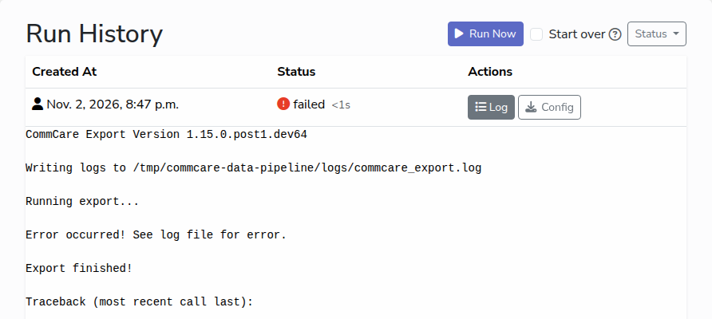

# Troubleshooting

Most problems show up as a run that failed, and the run's log says why. Start
there.

## Read the run's log

1. Open the export, refresh or forwarder from its list page.
2. In **Run History**, click **Log** on the failed run. The log opens under the
   row.
3. Read from the bottom: the last lines say what went wrong.

Common messages in an export's log:

| The log says                                | What it means                                                                                                           |
| ------------------------------------------- | ----------------------------------------------------------------------------------------------------------------------- |
| `401 Client Error: Unauthorized`            | The account's API key is wrong or was turned off in CommCare HQ. Make a new key and edit the account.                   |
| `403 Client Error: Forbidden`               | The account's user cannot see this project space in CommCare HQ. Give them access, or use another account.              |
| `404 Client Error: Not Found`               | The project space name is wrong, or the saved export was deleted in CommCare HQ. Check the project; re-pick the export. |
| `Connection refused` or `could not connect` | The database's address or port is wrong, or the database is not reachable from this computer.                           |
| `password authentication failed`            | The database user or password in the connection string is wrong. Edit the database and type the string again.           |
| `Can't open lib 'ODBC Driver ...'`          | SQL Server only: Microsoft's ODBC Driver for SQL Server is not installed on this computer.                              |

## A run shows Interrupted

The app was closed, or the computer was shut down, while the run was going. The
run is repeated once, automatically, the next time the app starts, and the
banner at the top of the page lists it until you close the banner.

## The app does not open

- **Nothing happens, or the browser opens instead of a window.** The app is
  already running. Opening it again shows the running app in your browser. Look
  for it in the taskbar or dock, or close it from there first.
- **On a server, the launcher stops at once** and `launcher.log` ends with an
  error saying the address is already in use. Another program has the port.
  Start with another `--port`.

## I forgot my password

The **Forgot password?** link on the sign-in page sends an email only when the
app has been given an email server, which the desktop app has not. Ask an
administrator to reset your password; see [Manage users](manage-users.md). If
you run the app on your own computer and are its only user, there is no one to
ask and no way back in: delete the data directory (see below) and set the app up
again. The data already in your database is not affected.

## A task shows Overdue

A scheduled run is more than a few minutes late while the app is open. Usually
the app was just opened after being closed for a while, and the missed run
starts within a minute. If it stays overdue, the part of the app that runs tasks
has stopped: close the app completely and open it again, then look in
`launcher.log` in the data directory for errors.

## The CommCare Export list is empty

On the export form, the list fills only after you pick both the **Project** and
the **Account**. "No configs available" means there are no saved exports in
CommCare HQ for that project space. "Error loading configs" with both chosen
means the account's API key is wrong, or its user cannot see the project space.
Check both in CommCare HQ.

## Asking for help

Send the logs with your question. They are in the `logs` folder of the data
directory:

| Platform | Data directory                                |
| -------- | --------------------------------------------- |
| Windows  | `%LOCALAPPDATA%\commcare-sync`                |
| macOS    | `~/Library/Application Support/commcare-sync` |
| Linux    | `~/.local/share/commcare-sync`                |

To open the folder, paste the path into the address bar of File Explorer on
Windows, or in Finder choose **Go → Go to Folder** and paste it. Zip the `logs`
folder and attach it, together with the version you are using and what you did.
The logs are not meant to contain passwords or API keys, but have a look before
sharing them.

Administrators can also download the export tool's shared log without finding
the folder: open the ≡ menu in the top right and choose **Download Logs**. It
downloads `commcare_export.log`, which has the output of every export run in one
file.
